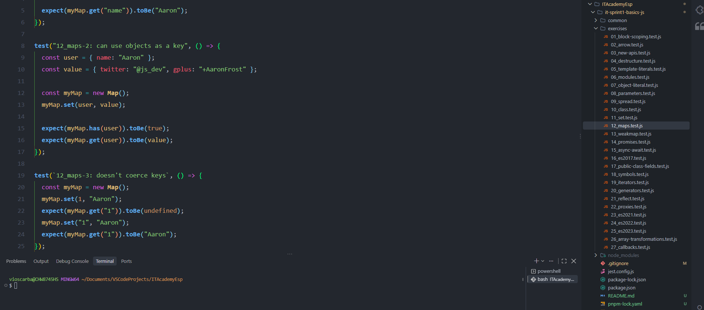
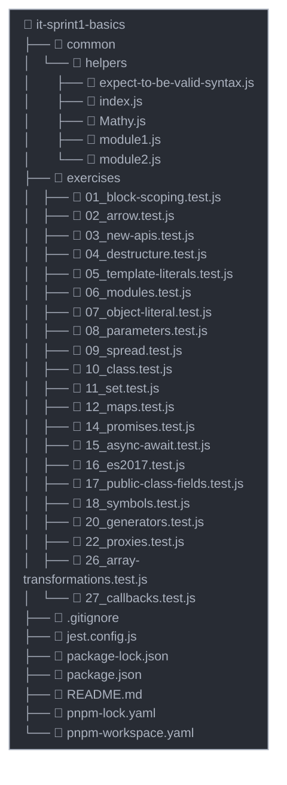

# Nombre del proyecto

Funcionalidades modernas de JavaScript

---

## Descripción

Este proyecto está diseñado para introducirnos a las características modernas de JavaScript, desde ES6 hasta las versiones más recientes. A través de ejercicios prácticos, exploraremos conceptos como el _block scoping, funciones flecha, literales de plantilla, destructuración, nuevas APIs y mucho más_. El objetivo es adquirir una comprensión sólida de cómo utilizar estas funcionalidades para escribir código más eficiente, legible y mantenible.

---

## Vista previa



---

## Estructura del proyecto



---

## Tecnologías usadas

- **JavaScript** (Estructura semántica)
- **Jest** (Entorno de pruebas)
- **pnpm / npm** (Gestores de paquetes)

---

## Instalación y ejecución

Sigue estos pasos ordenados para configurar tu entorno, instalar todas las dependencias necesarias y ejecutar el proyecto localmente:

### 0. Preparar el entorno (Requisitos)

Asegúrate de tener instalados los siguientes programas globales:

- Un navegador web moderno (Chrome, Firefox, Edge, Safari)
- Un editor de código (recomendado: **VS Code**)
- **Git**: Requerido para clonar y gestionar el repositorio.
  - _Windows/Mac:_ Descarga el instalador oficial desde [git-scm.com](https://git-scm.com).
  - _Linux (Ubuntu/Debian):_ Instálalo desde la terminal ejecutando `sudo apt install git`.
  - _Puedes verificar tu instalación ejecutando `git --version` en la terminal._

### 1. Instalar Node.js

Este proyecto requiere una versión LTS activa de Node.js (**v20.x o superior**). Elige uno de los siguientes métodos para instalarlo:

- **Opción A (Recomendada - Instalador Oficial):** Descarga e instala la versión LTS correspondiente a tu sistema operativo desde la [web oficial de Node.js](https://nodejs.org).
- **Opción B (Para desarrolladores - Usando NVM):** Si usas el gestor de versiones Node Version Manager, ejecuta los siguientes comandos en tu terminal:

  ```bash
  nvm install 20
  nvm use 20
  ```

_Puedes verificar que se ha instalado correctamente abriendo una nueva terminal y ejecutando `node -v` y `npm -v`._

### 2. Instalar el gestor de paquetes pnpm (Recomendado)

El proyecto utiliza `pnpm` debido a los archivos `pnpm-lock.yaml` y `pnpm-workspace.yaml`. Si todavía no lo tienes de forma global en tu máquina, instálalo ejecutando:

```bash
npm install -g pnpm
```

### 3. Clonar el repositorio

```bash
git clone https://github.com/osbavi/it-sprint1-basics-js.git
cd it-sprint1-basics-js
```

### 4. Desvincular el repositorio original de osbavi

Ejecuta este comando para eliminar el enlace remoto inicial:

```bash
git remote rm origin
```

### 5. Vincular el proyecto a tu propia cuenta de GitHub

Sustituye `<URL-de-tu-repositorio>` por la URL de tu repositorio personal de GitHub:

```bash
git remote add origin <URL-de-tu-repositorio>
```

### 6. Instalar las dependencias

Instala los paquetes necesarios utilizando el gestor que prefieras:

_Si usas pnpm (recomendado):_

```bash
pnpm install
```

_Si usas npm:_

```bash
npm install
```

### 7. Ejecutar las pruebas (Tests)

Utiliza Jest para comprobar qué ejercicios pasan las pruebas y cuáles tienes que completar:

_Si usas pnpm:_

```bash
pnpm test
```

_Si usas npm:_

```bash
npm test
```

---

## Colaboradores

- **Oscar Ballart Vilella** - [GitHub](https://github.com/osbavi)
- **Cris Mouta** - [GitHub](https://github.com/crismouta)
- **Rocío Cejudo** - [GitHub](https://github.com/rcellas)

---

## Licencia

Este proyecto está bajo la Licencia MIT; consulta el archivo [LICENSE](LICENSE) para obtener más detalles.
